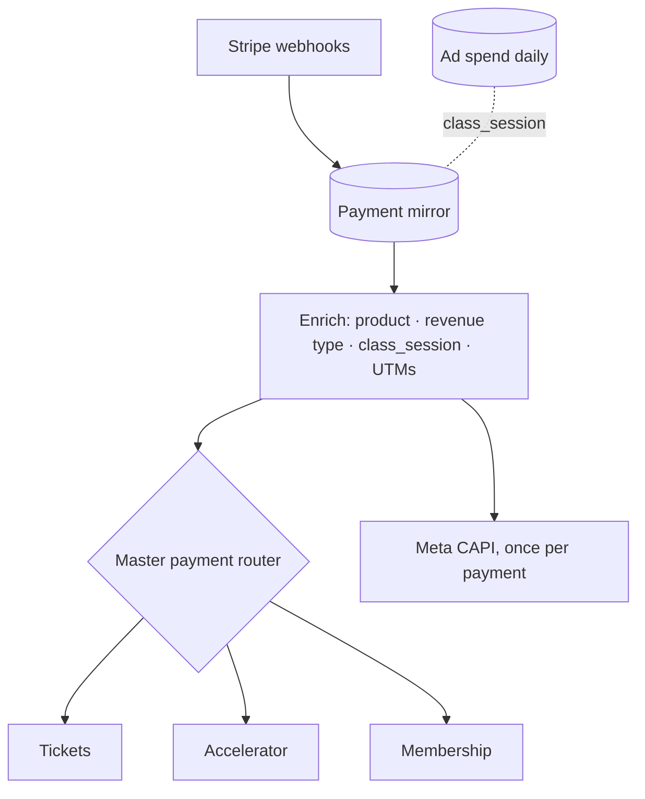
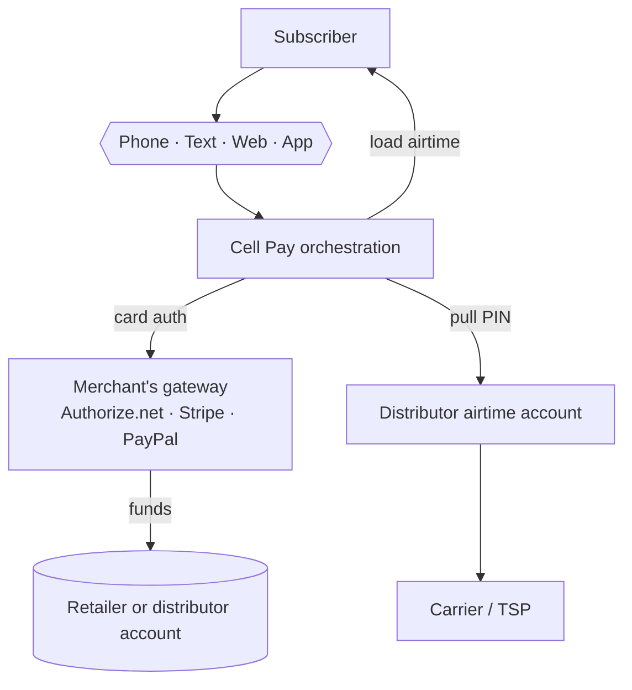
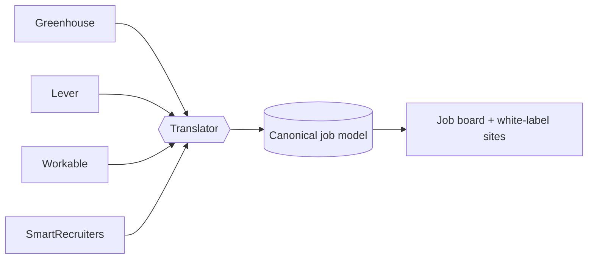

# Systems & Integration Architecture Portfolio

**C. Jibril Sulaiman II** · AWS Certified Solutions Architect, Associate · [jibrilsulaiman.com](https://jibrilsulaiman.com)

Original architecture work from three companies across fifteen years, organized by the problem each system solves. Every record covers the problem, the design decisions, the patterns it demonstrates, and a redrawn diagram, with the original diagrams alongside where they exist.

**View the full portfolio:** open [`index.html`](index.html), or the GitHub Pages site if enabled for this repo.

## Empify (Sept 2025 to present) · Sr. Manager, Marketing Technology & Revenue Systems

Revenue systems for a financial education company that runs weekly live free classes. Ten systems, 25 linked public repos. Built the HubSpot revenue platform from an empty portal in summer 2026 and integrated payments, community, SMS, calling and ad platforms into one data model.

## Era 1 · Pay Cell Systems Inc. (c. 2011–2014) · President

Prepaid wireless payments platform: subscribers refill airtime by phone, text, web, app or in-store kiosk, settled through card gateways and fulfilled through airtime distributor APIs.

| System | Patterns |
|---|---|
| Cell Pay Distribution Platform | Multi-tenant SaaS, merchant-of-record design, partner API credentials, revenue share model |
| Pay-by-Phone IVR | Authorize.net, XML airtime API, async fulfillment, failure-path design, attribution |
| Self-Service Payment Kiosk | Hardware events, state machine, per-step timeouts, shared services |
| Fulfillment & Card Authentication | 3-D Secure sequence, DTMF auto-dialer (RPA on a phone line) |
| Dealer Portal Roadmap | Build vs buy, cost estimation, unit pricing |
| Feature Marketplace Sketch | Two-sided marketplace, escrow, social as event bus |

## Era 2 · Incluzion / Spendwith Corp (c. 2019–2021) · CEO / Founder, then CTO

Remote-work platform for Black and Latinx professionals: jobs board, services marketplace, learning platform and community.

| System | Patterns |
|---|---|
| ATS Translator API | Adapter pattern, canonical data model across 7 ATSs |
| Job Import Pipeline | ETL, idempotent upsert, entity resolution, lineage tags, white label |
| Incluzion Platform Map | Closed-loop CRM write-back, browser extension, observability log |
| Split Placement Network | Role-based views, feature flag on record, marketplace spec |
| Segmented GTM Funnel | ICP segmentation, tiered pricing, packaging by integration state |
| Speed-to-Lead Automation | Event-driven workflow, business-hours guard, exit conditions |
| Incluzion Operating Model | Ownership mapping, org design |

## Repository contents

- `index.html` — the full portfolio page (self-contained; Mermaid diagrams render in the browser)
- `pc/` — original diagrams and whiteboard photos

Client contact details and a test phone number in two original diagrams have been left out on purpose.
