# Systems & Integration Architecture

**C. Jibril Sulaiman II** · [jibrilsulaiman.com](https://jibrilsulaiman.com)

<sub>Design archive, 2011 to 2026 · organized for solutions architecture roles</sub>

Original architecture work across three companies and fifteen years: the Empify revenue platform (HubSpot, Stripe, community, SMS and ad integrations, current), the Incluzion jobs and community platform, and the Pay Cell Systems prepaid payments platform (IVR, kiosk, distributor network). Each record states the problem, the design decisions, the patterns it demonstrates, and a talking point for interviews. Original diagrams are shown where they exist, and Empify records link to the public code.

**23** systems documented · **30** original diagrams · **AWS** Certified Solutions Architect, Associate

**View the rendered page:** open [`index.html`](index.html), or the GitHub Pages site if enabled for this repo.

## Pattern coverage

Which architecture patterns each diagram shows. A filled dot means the pattern is the core of the design; a ring means it appears as a supporting element.

| Diagram | Payment processing | Schema normalization | API / webhook integration | Idempotent import & dedupe | Multi-tenant / white label | Event-driven automation | Marketplace roles & UX | Monetization model |
|:---|:---:|:---:|:---:|:---:|:---:|:---:|:---:|:---:|
| **Empify · Sept 2025 to present** | | | | | | | | |
| HubSpot Revenue Data Model | ○ | ● | ○ | ● |  |  |  | ○ |
| Stripe Revenue Mirror & Routing | ● | ○ | ● | ● |  | ● |  | ● |
| Conversion Attribution Pipeline | ○ | ○ | ● | ● |  | ● |  |  |
| Free Class Engine |  |  | ○ |  | ● | ● |  | ○ |
| Member Lifecycle & Retention | ● |  | ● | ○ |  | ● |  | ○ |
| Sales Routing & Conversations |  |  | ● |  |  | ● |  |  |
| Conversational AI & Knowledge |  | ○ | ● |  |  | ● |  |  |
| Email Infrastructure |  |  | ○ |  | ● | ○ |  |  |
| CRM Consolidation & Migration |  | ● | ● | ● |  | ○ |  |  |
| Salesforce Referral-to-Delivery |  | ○ | ● |  |  | ● | ○ |  |
| **Incluzion and client work · c. 2019–2021** | | | | | | | | |
| ATS Translator API |  | ● | ● |  |  |  |  |  |
| Job Import Pipeline |  | ○ | ● | ● | ● |  |  |  |
| Incluzion Platform Map |  |  | ● | ○ |  | ● | ○ | ○ |
| Split Placement Network |  |  |  |  |  |  | ● | ○ |
| Segmented GTM Funnel |  |  |  |  | ● |  |  | ● |
| Speed-to-Lead Automation |  |  | ○ |  |  | ● |  |  |
| Incluzion Operating Model |  |  | ○ |  |  |  | ○ |  |
| **Pay Cell Systems Inc. · c. 2011–2014** | | | | | | | | |
| Cell Pay Distribution Platform | ● |  | ● |  | ● |  | ○ | ● |
| Pay-by-Phone IVR | ● | ○ | ● |  | ● | ● |  | ○ |
| Self-Service Payment Kiosk | ● |  | ● |  |  | ● |  | ○ |
| Fulfillment & Card Authentication | ● |  | ● |  |  | ● |  |  |
| Dealer Portal Roadmap | ○ |  | ○ |  | ○ |  | ○ | ● |
| Feature Marketplace Sketch | ○ |  | ○ |  |  | ● | ● |  |

## Empify: revenue systems for a financial education company

<sub>Current · Sept 2025 to present · Sr. Manager, Marketing Technology & Revenue Systems</sub>

Function head for marketing technology, reporting to the CEO. The business runs on weekly live free classes (Stocks & ETFs, REITs, Dividends, Retirement) that convert to toolkits, memberships, accelerators and summit tickets. I consolidated three CRMs into GoHighLevel, then built the HubSpot revenue platform from an empty portal in summer 2026, and wired payments, community, SMS, calling, AI agents and ad platforms into one data model. Most builds are published as step-by-step guides with code on GitHub, linked on each record. Scale is shown rounded; internal IDs, financials and names are left out.

### Domain 1 · Data model, revenue & attribution

#### HubSpot Revenue Data Model

*A custom object model that describes the business HubSpot's stock objects don't: classes, registrations, payments, subscriptions, ad spend, tickets and kits, joined by one session key.*

<sub>Source: HubSpot build-out report (audit log of 44K+ events, July to Sept 2026)</sub>

**Problem**

Revenue, ad spend and class attendance lived in Stripe, Meta, GoHighLevel and spreadsheets. Nobody could answer "what did this class cost, and what did it earn?" without a manual join.

**Design**

- Nine custom objects: Class Registration, Free Class Configuration, Stripe Payment and Subscription mirrors, Ad Spend Daily, Ticket and Prep Kit purchases, In-Person Event Registration and Shopify Customers, backed by 230+ custom properties.
- A single join key, `class_session` (date plus topic, for example `2026-08-19 - Stocks & ETFs`), is written by workflow onto registrations, payments and daily ad spend. Cost per lead and revenue per class roll up without a spreadsheet.
- Registration schema rebuilt off inherited GoHighLevel naming (19 legacy numbered fields archived) onto clean fields with first-touch and last-touch UTM pairs.
- Cross-platform IDs on the contact (GoHighLevel, SlickText, Mighty Networks) so every system can find the same person.
- Holds 700K+ contacts and 330K+ class registrations.

**Patterns:** Custom objects · Join-key design · Schema migration · First / last touch attribution

> "I picked one key every system could compute, class date plus topic, and made a workflow stamp it everywhere. That one field turned three disconnected datasets into a cost-per-class report."


<details>
<summary>Diagram source (Mermaid)</summary>

```text
erDiagram
  CONTACT ||--o{ CLASS_REGISTRATION : registers
  CONTACT ||--o{ PAYMENT_MIRROR : pays
  CONTACT ||--o{ SUBSCRIPTION_MIRROR : subscribes
  FREE_CLASS_CONFIG ||--o{ CLASS_REGISTRATION : "drives"
  CLASS_REGISTRATION }o--|| CLASS_SESSION : "class_session"
  PAYMENT_MIRROR }o--|| CLASS_SESSION : "class_session"
  AD_SPEND_DAILY }o--|| CLASS_SESSION : "class_session"
  CLASS_SESSION {
    string key "date + topic"
  }
```

</details>

#### Stripe Revenue Mirror & Payment Routing

*Every Stripe event, including the ones HubSpot's native sync never sees, lands in HubSpot as a payment record with a product name, then gets routed to the right fulfillment path.*

<sub>Source: build-out report · 4 public repos</sub>

**Problem**

HubSpot's Stripe sync copies live PaymentIntents only. Test payments, \$0 comp tickets and checkout sessions never arrived, payment records carried no product field, and nothing could be routed or reported by product.

**Design**

- Stripe webhooks post straight into HubSpot workflow triggers with no middleware. Payloads are trimmed to fit HubSpot's 50-property event limit, whose error message points at the wrong cause.
- Three data-model generations in two days. A charge-based object was dropped within a minute for payment intents; generation two was replaced the next day by mirrors with invoice and product fields, and the old objects and 17,911 records were torn down.
- The 80-property payment mirror adds what Stripe lacks: `revenue_type`, `product_category`, `class_session`, seven UTM fields and a CAPI-sent timestamp.
- A custom code action reads each Checkout Session's line items and writes product names onto the payment. A master router fans buyers out to ticket, accelerator, coaching, membership and upsell workflows.
- Test-mode payments mirror into the same object, flagged `Record Environment = Test` and keyed on a unique test key so retried events update instead of duplicating. Payment workflows can be tested without real charges.
- \$0 checkouts (comp tickets, 100%-off codes) create no PaymentIntent, so a dedicated branch fetches them from Stripe, writes them to the orders object, and a backfill script loads the history.
- Holds 80K+ payment records and 4K+ subscriptions with live status.

**Patterns:** Webhooks without middleware · Data mirroring · Router / fan-out · Idempotency keys · Test vs prod isolation · Backfill

**Code:** [stripe-webhooks-to-hubspot-custom-events](https://github.com/carljibrilsulaimanii/stripe-webhooks-to-hubspot-custom-events) · [hubspot-stripe-payment-product-names-and-routing](https://github.com/carljibrilsulaimanii/hubspot-stripe-payment-product-names-and-routing) · [stripe-test-mode-to-hubspot-payment-mirror](https://github.com/carljibrilsulaimanii/stripe-test-mode-to-hubspot-payment-mirror) · [hubspot-stripe-zero-dollar-checkout-sync](https://github.com/carljibrilsulaimanii/hubspot-stripe-zero-dollar-checkout-sync)

> "I threw away two versions on purpose. Modeling on charges was wrong for subscriptions, and finding that out in one day was cheaper than reporting on the wrong grain for a year."


<details>
<summary>Diagram source (Mermaid)</summary>

```text
flowchart TD
  ST[Stripe events<br/>live · test · $0 checkout] -- webhook --> HS[HubSpot workflow trigger]
  HS --> PM[(Payment mirror<br/>80 properties)]
  HS -- test mode --> TM[Same object<br/>env = Test · unique key]
  HS -- $0 session --> OR[(Orders object)]
  PM --> EN[Custom code: product names<br/>from checkout line items]
  EN --> R{Master payment router}
  R --> T1[Tickets]
  R --> T2[Accelerator]
  R --> T3[Coaching]
  R --> T4[Membership]
  R --> T5[Kits & upsells]
```

</details>

#### Conversion Attribution Pipeline

*Campaign source carried from the first ad click through a HubSpot order form and a Stripe Payment Link onto the payment record, then sent server-side to Meta and Google once per real sale or lead.*

<sub>Source: weekly reports · 4 public repos</sub>

**Problem**

30 to 50% of purchase revenue had no source. HubSpot form redirects dropped UTMs, Stripe silently drops UTM values it dislikes, and HubSpot's native conversion events could not send one deduplicated purchase per real payment. Ad platforms were optimizing on wrong signals.

**Design**

- A site header script stores UTMs and click IDs in a first-party cookie on landing, so they survive form redirects.
- A two-step HubSpot order form makes every buyer a contact first, then hands them to a Stripe Payment Link with email prefilled and the campaign attached.
- Payment Links redirect after payment, so Stripe copies UTMs onto the success URL. A workflow reads them back from the Checkout Session and writes them onto the payment record.
- Four custom code actions send Purchase and Lead to the Meta Conversions API and Google Ads: one event per settled payment at the amount actually charged, one per lead even on duplicate submits, with correct hashing. HubSpot's native integration was diagnosed against each failure and confirmed unsuitable by HubSpot support.
- Upstream fixes: ad-ID hidden fields, landing-URL capture persisted across multi-step funnels, pixel and CAPI audits that found duplicate events and a token with the wrong scope.
- Direct Graph API access gives Claude read access to ad accounts the Meta Ads MCP connector won't serve, without business-admin rights.

**Patterns:** Server-side conversions · Deduplication · First-party cookies · Meta CAPI · Google Ads API

**Code:** [hubspot-order-form-stripe-checkout-link-integration](https://github.com/carljibrilsulaimanii/hubspot-order-form-stripe-checkout-link-integration) · [hubspot-stripe-utm-attribution](https://github.com/carljibrilsulaimanii/hubspot-stripe-utm-attribution) · [hubspot-capi-server-side-lead-and-purchase-conversions-meta-google](https://github.com/carljibrilsulaimanii/hubspot-capi-server-side-lead-and-purchase-conversions-meta-google) · [claude-meta-ads-api-access-without-mcp](https://github.com/carljibrilsulaimanii/claude-meta-ads-api-access-without-mcp)

> "Every failure in attribution is silent. A double count or a lost sale doesn't error; it just teaches the campaign the wrong thing. So every step in this pipeline ends in a check."


<details>
<summary>Diagram source (Mermaid)</summary>

```text
flowchart LR
  AD[Ad click<br/>UTMs + click IDs] --> CK[First-party cookie]
  CK --> F1[Order form step 1<br/>contact created]
  F1 --> PL[Stripe Payment Link<br/>email + campaign attached]
  PL --> SU[Success URL<br/>carries UTMs]
  SU --> WF[Workflow reads Checkout Session]
  WF --> PM[(Payment record<br/>amount + source)]
  PM --> M[Meta CAPI Purchase]
  PM --> G[Google Ads conversion]
```

</details>

### Domain 2 · Funnel engine & member lifecycle

#### Free Class Engine

*One configuration record drives a whole class launch, first in GoHighLevel custom values and then rebuilt as a HubSpot custom object: pages, calendar links, SMS schedules, redirects and tags across five subdomains and 100+ landing pages.*

<sub>Source: weekly reports, build-out report · 3 public repos</sub>

**Problem**

Every weekly class was launched by hand: titles, dates, YouTube links, SMS lists and tags set one by one across dozens of pages. Mistakes reached the public, and two classes could not run in the same week.

**Design**

- In GoHighLevel, every class detail lives in custom values; dual-class infrastructure gives each topic its own value and tag set so two classes can run at once.
- HubSpot has no account-wide custom values, so I built the equivalent: a configuration object with one record per class, read by seven custom page modules (date, countdown, replay window, video, calendar button) and by workflows through an "Active <Topic> Config" data source.
- A self-hosted Add to Calendar bridge replaced a paid service: one page reads the event from custom values, converts Eastern time to UTC, and returns a Google link or an .ics file. Fixed daylight-saving, HTML-in-values and merge-tag crashes across five versions.
- An SMS scheduler turns one class date into nine SlickText campaigns, converting each Eastern send time to UTC correctly across daylight saving. A list-sync step finds or creates each registrant in SlickText first.
- A numbered lifecycle: registration record, attribution events, nurture, attended (from the watch-now page) or watched replay, each with its own nurture, then the offer.
- Permanent restream redirects update when the class flips, so nobody rushes a new YouTube link at the end of a live class.

**Patterns:** Configuration-driven design · Lifecycle state machine · Time-zone correctness · Platform parity · Vendor replacement

**Code:** [ghl-custom-values-in-hubspot-for-dynamically-updating-funnels](https://github.com/carljibrilsulaimanii/ghl-custom-values-in-hubspot-for-dynamically-updating-funnels) · [custom-add-to-calendar-bridge](https://github.com/carljibrilsulaimanii/custom-add-to-calendar-bridge) · [gohighlevel-slicktext-sms-sync-and-campaign-scheduler](https://github.com/carljibrilsulaimanii/gohighlevel-slicktext-sms-sync-and-campaign-scheduler)

> "I moved the launch from a checklist to a record. Change one configuration object and every page, calendar link, SMS campaign and tag for that class follows."


<details>
<summary>Diagram source (Mermaid)</summary>

```text
flowchart LR
  CFG[(Class configuration<br/>GHL custom values → HubSpot object)] --> PG[Pages · countdown · replay]
  CFG --> CAL[Add to Calendar bridge]
  CFG --> SMS[9 SlickText campaigns<br/>ET → UTC]
  CFG --> RD[Redirects + restream link]
  PG --> R1[Registration record]
  R1 --> A{Attended?}
  A -- Watch now --> R4[Attended nurture]
  A -- Replay --> R5[Replay nurture]
  R4 --> OF[Offer]
  R5 --> OF
```

</details>

#### Member Lifecycle & Retention

*Membership events from Mighty Networks and Stripe drive onboarding, engagement scoring, cancellation saves and failed-payment recovery, all from one router.*

<sub>Source: weekly reports · 5 public repos</sub>

**Problem**

Members bought in Mighty Networks and paid in Stripe, but the CRM did not know who joined, who stalled, who cancelled or whose card failed. Churn was invisible until it happened.

**Design**

- A webhook router receives every Mighty Networks event at one URL and routes on `event_type`: purchases (skip \$0, tag annual or monthly, start onboarding, tag renewal month), cancellations, joins, purchase requests and course progress.
- Cancellation save: the webhook fires on the cancel click, not when access ends, so the router holds the contact until 7 days before access ends, then sends a downsell sequence.
- Failed-payment recovery replaced a paid dunning tool: `charge.failed` records the decline reason, `invoice.payment_failed` sends a sequence chosen by that reason with the member's own invoice link. Initial emails reached about 50% opens.
- Engagement: a daily Apps Script copies each member's last-visited date (Host-token Headless API only) and pushes only changed dates. It feeds a hot / warm / cold / dormant / frozen score. A bulk-paste bug was fixed with an hourly diff-hashed sync.
- Course progress: one custom-object record per member per course, created once then updated, after mapping the request shape GoHighLevel's API accepts instead of a bare 422.
- Onboarding activation: an SMS check-in asks which of five milestones a member finished, tags progress 0 to 100%, sends one next step, and nudges through a Conversation AI bot. Built and tested; not yet launched to live members.

**Patterns:** Event router · Churn prevention · Dunning · Diff-based sync · Engagement scoring

**Code:** [mighty-networks-webhook-router-gohighlevel](https://github.com/carljibrilsulaimanii/mighty-networks-webhook-router-gohighlevel) · [stripe-gohighlevel-failed-payment-recovery](https://github.com/carljibrilsulaimanii/stripe-gohighlevel-failed-payment-recovery) · [mighty-networks-hubspot-last-visited-sync](https://github.com/carljibrilsulaimanii/mighty-networks-hubspot-last-visited-sync) · [mighty-networks-course-progress-to-gohighlevel-custom-objects](https://github.com/carljibrilsulaimanii/mighty-networks-course-progress-to-gohighlevel-custom-objects) · [gohighlevel-conversation-ai-onboarding-activation-bot](https://github.com/carljibrilsulaimanii/gohighlevel-conversation-ai-onboarding-activation-bot)

> "The cancel webhook fires the moment someone clicks cancel, weeks before they lose access. Holding them until a week before the end date turned a lost member into a save window."


<details>
<summary>Diagram source (Mermaid)</summary>

```text
flowchart TD
  MN[Mighty Networks webhook] --> R{Router on event_type}
  R -- purchased --> P[Tag plan · start onboarding]
  R -- canceled --> C[Hold until 7 days<br/>before access ends] --> DS[Downsell sequence]
  R -- course progress --> CO[(Progress record<br/>per member per course)]
  R -- joined --> J[Create contact]
  ST[Stripe] -- charge.failed --> FR[Record decline reason]
  ST -- invoice.payment_failed --> FS[Sequence by reason<br/>+ invoice link]
  LV[Daily last-visited sync] --> SC[Hot · warm · cold · dormant · frozen]
  P --> OB[Activation check-in bot]
```

</details>

### Domain 3 · Conversations, sales routing & AI agents

#### Sales Routing & Conversations

*Calls, texts, community DMs and bookings routed to the right rep and logged on the contact, including an AI voice and SMS agent that books straight into HubSpot.*

<sub>Source: weekly reports · 3 public repos</sub>

**Problem**

Inbound calls went unhandled, every marketing blast flooded reps' inboxes with STOP and thumbs-up replies, members' Mighty Networks DMs lived outside the CRM, and high-ticket enrollment calls had no-shows.

**Design**

- Aloware AI agent booking: the agent books by SMS or voice onto a rep's real calendar through HubSpot's round-robin meeting link. No scheduler, no middleware. Every setup step ends in a check because the failure mode is HTTP 200 with nothing booked.
- Filtered inboxes (designed, not yet built): an AI agent sorts replies to marketing texts and moves only buyers to a toll-free sales line and their owner with one automatic text, because Aloware cannot move a conversation between lines.
- Two-way Mighty Networks DM sync in Apps Script: member DMs become notes on the HubSpot contact every 15 minutes; a rep's reply typed in HubSpot goes out as a DM every 5. It refuses to write until an ID check and inbox baseline pass.
- GoHighLevel phone tree (enrollment, members, support), role-scoped inboxes (each rep sees only their contacts; collections sees only failed payments), auto-assigned conversations and a round-robin calendar.
- Enrollment call protection: after booking, leads are classified engaged, silent or at-risk, message cadence adjusts, and at-risk appointments go to a review queue.

**Patterns:** AI agent tooling · Two-way sync · Round robin · Role-based access · Aloware · HubSpot · GHL

**Code:** [aloware-ai-hubspot-scheduling](https://github.com/carljibrilsulaimanii/aloware-ai-hubspot-scheduling) · [mighty-networks-hubspot-dm-integration](https://github.com/carljibrilsulaimanii/mighty-networks-hubspot-dm-integration) · [filtered-sms-inboxes-auto-update-outbound-channel](https://github.com/carljibrilsulaimanii/filtered-sms-inboxes-auto-update-outbound-channel)

> "Most failures in this stack are silent: a 200 response with nothing booked. I design every integration so the last step is a check a non-engineer can run."


<details>
<summary>Diagram source (Mermaid)</summary>

```text
flowchart LR
  C[Contact SMS or call] --> AI[Aloware AI agent]
  AI -- book --> RR[HubSpot round-robin<br/>meeting link]
  RR --> REP[Rep calendar + meeting on contact]
  MB[Marketing text reply] --> SORT{AI sorts reply}
  SORT -- buyer --> SL[Toll-free sales line<br/>+ owner]
  SORT -- noise --> X[Stays in marketing]
  MDM[Mighty Networks DM] <-- 15 / 5 min --> HN[HubSpot contact notes<br/>+ reply property]
```

</details>

#### Conversational AI & Knowledge Pipeline

*A customer-facing AI agent on SMS, social and the member community, fed by a transcription pipeline that turns calls, live classes and meetings into its knowledge base, plus Claude connected to the CRM and ad accounts for operations.*

<sub>Source: weekly reports · 4 public repos</sub>

**Problem**

Support, sales and member questions arrived around the clock across SMS, Facebook, Instagram and the community. The answers already existed, but only inside thousands of call recordings, class videos and podcast episodes.

**Design**

- A GoHighLevel Conversation AI agent replaced ManyChat on social, runs as a help-desk bot embedded in Mighty Networks, and answers on the replay page.
- Human-in-the-loop controls: a thumbs-down training loop run by support, a stop-bot tag, 10 minutes of silence after a rep sends a manual message, and no call booking offered to non-customers.
- Knowledge pipeline: thousands of call recordings bulk-transcribed through a declare, upload, poll, download API pattern, cleaned into readable transcripts, and packed into CSVs under the knowledge base's 50 MB limit.
- Long recordings: a Gemini pipeline splits 7+ hour meetings into 45-minute chunks, uses a voice sample per speaker for labels, shifts timestamps back to the meeting clock, and resumes across free-tier quota days.
- Live class questions: the YouTube chat replay is exported and filtered to audience questions for FAQs and follow-up.
- Operations: Claude connected to GoHighLevel and HubSpot through MCP with read-only scopes, and to Meta ad accounts through the Graph API. Weekly reporting is assembled by Claude from seven sources (Slack, calendar, email, Asana, CRM audit logs and AI chat exports).

**Patterns:** LLM agents · Human in the loop · Transcription pipelines · MCP · Python · Gemini · Claude

**Code:** [twilio-call-recordings-bulk-transcription-elevateai](https://github.com/carljibrilsulaimanii/twilio-call-recordings-bulk-transcription-elevateai) · [gemini-long-meeting-transcription-with-speaker-labels](https://github.com/carljibrilsulaimanii/gemini-long-meeting-transcription-with-speaker-labels) · [youtube-live-chat-questions-export](https://github.com/carljibrilsulaimanii/youtube-live-chat-questions-export) · [python-utility-scripts](https://github.com/carljibrilsulaimanii/python-utility-scripts)

> "The bot is only as good as what it has read. Most of the work was the pipeline that turned years of calls and classes into something it could read."


<details>
<summary>Diagram source (Mermaid)</summary>

```text
flowchart LR
  REC[Call recordings] --> TR[Bulk transcription]
  MTG[7+ hr meetings] --> GM[Gemini chunks<br/>+ speaker labels]
  YT[YouTube Live chat] --> Q[Question export]
  TR --> KB[(Knowledge base<br/>CSV under 50 MB)]
  GM --> KB
  Q --> KB
  KB --> BOT[Conversation AI agent<br/>SMS · social · community]
  BOT -- thumbs down --> TRN[Support retrains]
  REP[Rep sends message] -. pause bot .-> BOT
```

</details>

### Domain 4 · Platform operations & migration

#### Email Infrastructure Re-architecture

*Bulk sending to a half-million-contact list moved onto a dedicated provider and rebuilt on correct DNS, authentication and suppression, after four platform blocks in six weeks.*

<sub>Source: weekly reports, May to July 2026</sub>

**Problem**

The CRM's built-in sender kept pausing at volume, was the largest line on the CRM bill, and the vendor's support said DNS was clean when it wasn't.

**Design & incident response**

- Moved sending onto Mailgun (about 95% lower sending cost) with a new warmed sending subdomain, and rebuilt the delivery-tracking webhooks into the CRM.
- An independent DNS audit found the dedicated IP's reverse DNS had pointed to an unrelated domain for about five months. Fixed SPF, A and PTR records and filed the dispute in writing.
- A second, separate fault: the delivery webhook was broken, so 56,898 delivered emails showed as about 46 in the CRM. Delivery logs showed 97 to 99% actual delivery.
- Remediation on the next suspension: 2048-bit DKIM, a DMARC path from none to quarantine, suppression of hard bounces and 90-day non-openers, restart on engaged segments, and Mailgun kept as failover.
- Standing rules: test with mail-tester before any blast over 1,000 contacts, subscription categories so opt-outs still receive transactional mail, sends scheduled hours early to fit throughput limits, and marketing on its own subdomain to protect corporate reputation.

**Patterns:** Deliverability · SPF · DKIM · DMARC · PTR · Failover · Root-cause analysis · Mailgun

> "There were two unrelated faults at once: a bad PTR record and a broken tracking webhook. The second made the first look much worse than it was. I trust delivery logs over dashboards."


<details>
<summary>Diagram source (Mermaid)</summary>

```text
flowchart TD
  CRM[CRM campaigns] --> MG[Mailgun<br/>dedicated subdomain]
  MG --> DNS{DNS + auth<br/>SPF · DKIM 2048 · DMARC · PTR}
  DNS --> INBOX[Inbox providers]
  MG -- delivery webhooks --> CRM
  SUP[Suppression<br/>hard bounces · 90-day non-openers] --> CRM
  MT[mail-tester gate<br/>before 1,000+ sends] --> CRM
  MG -. failover .- ALT[Backup sender]
```

</details>

#### CRM Consolidation & Platform Migration

*Three contact databases merged into one GoHighLevel account, legacy tools retired, then a hybrid move to HubSpot as the revenue system of record.*

<sub>Source: weekly reports, Jan to July 2026 · 1 public repo</sub>

**Problem**

Contacts were split across ActiveCampaign and two GoHighLevel accounts with heavy overlap. The legacy email platform alone cost many times more than the CRM, and no tool gave a full view of a customer.

**Design**

- Deduplicated three lists to 520K+ unique contacts and migrated them into one GoHighLevel account, mapping tags case by case.
- Retired ActiveCampaign. Its API has no bulk delete and the rate limit made a 600K-contact wipe a 200-hour job, so I wrote a resumable script and finished with a server-side wipe through support.
- Moved the funnel and website off ClickFunnels, WordPress hosting and a paid page host onto the CRM, and moved the site to path-based URLs instead of new subdomains.
- Evaluated a BigQuery and Looker warehouse. The connector timed out on 530K contacts with no incremental loading, so I wrote a post-mortem and moved reporting to CRM dashboards and AI-assisted reports.
- Ran a GoHighLevel vs HubSpot gap analysis and chose a hybrid: HubSpot as the revenue system of record, SlickText kept for SMS, Aloware for telephony. The migration plan grew to a 76-page build document.
- Tech-stack and vendor-fee audits found an automation plan on the wrong tier, payment-processing fees to renegotiate and community-platform overages.

**Patterns:** Data migration · Deduplication · Build vs buy · Cost optimization · Post-mortems

**Code:** [activecampaign-bulk-contact-delete](https://github.com/carljibrilsulaimanii/activecampaign-bulk-contact-delete)

> "Knowing when to stop scripting is part of the job. The delete script worked, but at one call per second a support ticket was the faster architecture."


<details>
<summary>Diagram source (Mermaid)</summary>

```text
flowchart LR
  AC[(ActiveCampaign)] --> DD{Dedupe<br/>520K+ unique}
  G1[(GHL account A)] --> DD
  G2[(GHL account B)] --> DD
  DD --> GHL[(One GHL account)]
  GHL -- contact sync webhook --> HS[(HubSpot<br/>revenue system of record)]
  AC -. retired .-> X[Wiped]
  CF[ClickFunnels · WordPress] -. moved .-> GHL
```

</details>

### Independent build · Sept 2026

#### Salesforce Referral-to-Delivery

*A Salesforce Developer Org build for a consulting firm: partner referral intake through qualified lead, conversion, a guided sales Path, and an automatic project on Closed Won.*

<sub>Source: solutions architect assignment, video walkthrough · 1 public repo</sub>

**Design**

- Branded Web-to-Lead referral form that captures the referred business and the referring partner and tags the lead as a referral.
- Lead converts to Account, Contact and Opportunity; prospects, clients, referral partners and competitors are Account record types.
- Custom sales process with a guided Path. A record-triggered Flow creates a Project when a deal closes and promotes the account from Prospect to Client.
- Kept deliberately simple: standard objects first, one custom object, one automation. Delivered with a click-by-click build plan, QA and verification doc, and a timed training script.

**Patterns:** Salesforce · Web-to-Lead · Record types · Flow · Path

**Code:** [salesforce-referral-to-delivered-project](https://github.com/carljibrilsulaimanii/salesforce-referral-to-delivered-project) · [video walkthrough](https://youtu.be/ps1hYrhsKBM)


<details>
<summary>Diagram source (Mermaid)</summary>

```text
flowchart LR
  F[Partner referral form] --> L[Lead · referral]
  L --> Q{Qualified?}
  Q -- convert --> A[Account · Contact · Opportunity]
  A --> P[Guided sales Path]
  P -- Closed Won --> FL[Flow]
  FL --> PR[Project created]
  FL --> CL[Account → Client]
```

</details>

## Incluzion (Spendwith Corp) and client systems

<sub>2019 to 2021 · CEO / Founder, then CTO</sub>

A remote-work platform for Black and Latinx professionals with four products on one community: a remote jobs board, a services marketplace, a learning platform and the community itself. By March 2021 it had 3,000+ professionals, 300+ remote jobs posted and \$63K in 2020 revenue, sold as job posts (\$199+), job wrapping and hosted job sites (\$100+/mo) and retained search (20%). Diagrams below are clean redraws of the original Lucid files; originals are linked on each record.

### Domain 1 · Data integration

#### ATS Translator API

*A normalization layer that takes job data from seven applicant tracking systems and maps it into one canonical job-form schema.*

<sub>Source: Lucid · "Incluzion Translator API" · [Open original](https://lucid.app/lucidchart/ee267e83-670a-4334-b847-21bc3ce6dc42/edit)</sub>

**Problem**

Every ATS exposes jobs in a different shape. Greenhouse nests location under `offices[].name` and `location.name`; Lever uses `text`, `description` and `lists`. A job board that accepts all of them cannot hard-code each one into the posting form.

**Design**

- One adapter per source (Greenhouse, Lever, Workable, Recruitee, RecruiterBox, SmartRecruiters, JazzHR / Applytojob).
- A single translator maps source fields to a canonical model: `location → title → content → companyname`.
- The job form consumes only the canonical model, so adding an eighth ATS touches one adapter and nothing downstream.

**Patterns:** Adapter pattern · Canonical data model · REST · JSON mapping

> "I decoupled sources from the consumer with a canonical schema, which is the same move you make in an iPaaS or a CDP when you onboard a new connector."


<details>
<summary>Diagram source (Mermaid)</summary>

```text
flowchart LR
  GH[Greenhouse] --> T
  LV[Lever] --> T
  WK[Workable] --> T
  RC[Recruitee] --> T
  RB[RecruiterBox] --> T
  SR[SmartRecruiters] --> T
  JZ[JazzHR / Applytojob] --> T
  T{{Translator<br/>field mapping}} --> C[(Canonical job<br/>location · title<br/>content · company)]
  C --> F[Job posting form]
```

</details>

#### Job Import Pipeline

*Ingestion design for pulling portfolio-company jobs from VC firms into a WordPress job board, with dedupe rules, source tagging and white-label output.*

<sub>Source: Lucid · "WP Jobs Manager Flow" (4 regions, includes ERD entities) · [Open original](https://lucid.app/lucidchart/7492a216-52f3-471e-9d0f-52714abd4c88/edit)</sub>

**Problem**

VC funds publish portfolio jobs two ways: through Getro-hosted boards (Backstage Capital) or their own sites (Magma Partners). Jobs must attach to the right company profile, never duplicate on re-import, and stay filterable by origin.

**Design**

- Two ingestion paths: a Getro integration for hosted boards, a JobSpikr scraper integration for everything else.
- Match key is company name plus Getro company ID. If the company exists, jobs attach to it; if not, the pipeline creates the profile first, then imports.
- Each job carries a relational record: owning user (the fund), company profile, and an `imported` flag (`y` or `y-getro`).
- A filter entity separates `Imported`, `Getro` and `User Submitted` jobs on the board.
- The same data feeds a white-label board per customer at `company.incluzion.co`.

**Patterns:** ETL · Idempotent upsert · Entity resolution · Data lineage tags · Multi-tenant

> "The parent record has to exist before the child imports, and the match key prevents duplicates on every re-run. That is the same ordering problem as loading Accounts before Contacts and Opportunities in a CRM migration."


<details>
<summary>Diagram source (Mermaid)</summary>

```text
flowchart TD
  A[VC portfolio jobs] --> B{Hosted by Getro?}
  B -- Yes --> G[Getro integration]
  B -- No --> J[JobSpikr integration]
  G --> M{Company exists?<br/>name + Getro ID}
  J --> M
  M -- Yes --> X[Attach jobs to<br/>existing profile]
  M -- No --> N[Create company profile<br/>assign to fund user] --> X
  X --> D[(Job record<br/>user · company · imported flag)]
  D --> B1[Incluzion job board<br/>filters: Imported · Getro · User]
  D --> B2[White-label board<br/>company.incluzion.co]
```

</details>

**Shipped: from the 2021 sales deck**

<table>
<tr><td align="center" valign="top"><a href="pc/incluzion-amplification.jpg">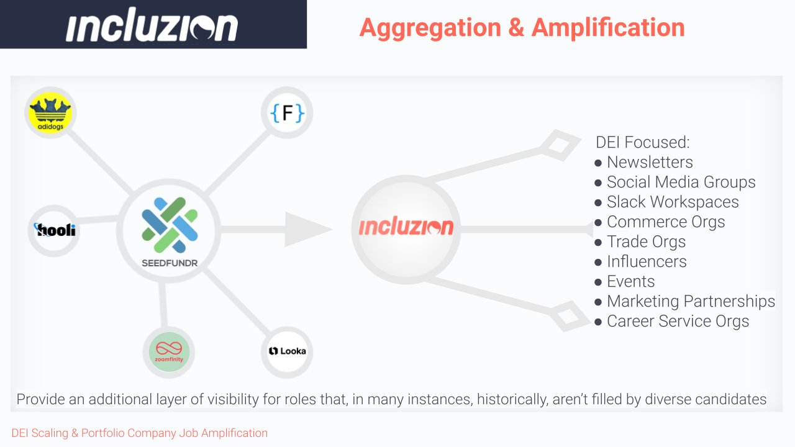</a><br><sub>Aggregation &amp; amplification</sub></td><td align="center" valign="top"><a href="pc/incluzion-three-steps.jpg">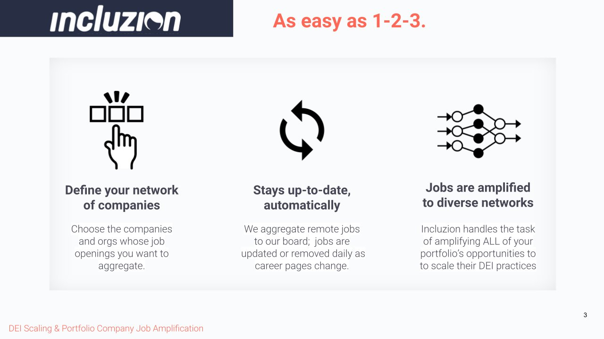</a><br><sub>Define, sync daily, amplify</sub></td></tr>
</table>

### Domain 2 · Platform architecture

#### Incluzion Platform Map

*End-to-end system map for Spendwith Corp (dba Incluzion): sourcing, CRM, job board, community, learning platform, support and growth tooling, with the people who operate each part.*

<sub>Source: Lucid · "Incluzion flow" (80+ nodes, sequenced API calls) · [Open original](https://lucid.app/lucidchart/74613a5b-d6c3-4093-ad98-e0638f582c69/edit)</sub>

**Problem**

Hiring managers post openings on LinkedIn and Twitter, not on job boards. The platform needed to capture those posts, turn them into free job listings automatically, and use that as the first touch in a sales motion.

**Design**

- A Chrome extension scrapes the post (name, handle, post URL, job link) and POSTs it to Nimble CRM.
- The extension reads back the contact ID, then calls the Incluzion Job Post API with `contactID` and `job_url`.
- The importer plugin creates a complimentary listing, then writes the public job URL back to the Nimble contact.
- LinkedIn and Twitter posting bots pull the URL from Nimble and reply to the original post with a call to action.
- A tracking dashboard logs contact ID, job URL, preview URL or error code, and update status for every import.
- Around the core: paid and nonprofit job posts with coupon codes, freelance RFPs with hours tracking (Tmetric), affiliate tracking (FirstPromoter), Mailchimp newsletter, Tawk.to support, Slack/BuddyBoss community, and a course platform.

**Patterns:** Closed-loop CRM write-back · Browser extension · REST · Observability log · Product-led growth

> "I designed the record to round-trip: the CRM contact gets the job URL back, so outreach and attribution run off one ID. I was CTO on this one."

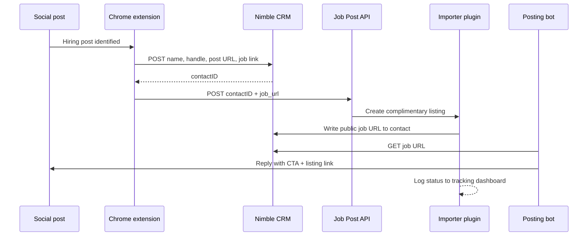

<details>
<summary>Diagram source (Mermaid)</summary>

```text
sequenceDiagram
  participant S as Social post
  participant X as Chrome extension
  participant N as Nimble CRM
  participant API as Job Post API
  participant P as Importer plugin
  participant B as Posting bot
  S->>X: Hiring post identified
  X->>N: POST name, handle, post URL, job link
  N-->>X: contactID
  X->>API: POST contactID + job_url
  API->>P: Create complimentary listing
  P->>N: Write public job URL to contact
  B->>N: GET job URL
  B->>S: Reply with CTA + listing link
  P-->>P: Log status to tracking dashboard
```

</details>

### Domain 3 · Product specification

#### Split Placement Network

*Feature specification for a two-sided recruiter marketplace inside the job board, where one recruiter owns the job and another supplies the candidate and they split the fee.*

<sub>Source: Lucid · "Split Placement Network" (screens annotated with field specs) · [Open original](https://lucid.app/lucidchart/747d37fe-885c-4de7-83c1-04ccff6cdd51/edit)</sub>

**Problem**

Extend an existing job board into a marketplace without forking it. Two personas, the job recruiter and the candidate recruiter, need different views of the same job record.

**Design**

- A single checkbox field (`Split Placement`, Yes/No) on the new-job form routes the job. Yes skips payment and publishes to the split board; No follows the normal flow.
- The split board is a filtered view of the normal board, not a separate system.
- Candidate recruiters get three tabs: Marketplace, My Saved Jobs, My Candidates. Job detail modals show the description plus a Job Insights tab for owner announcements and Q&A.
- Job owners get a dashboard with applications per job, a public notes field, and counts for submitted, interviewed and rejected candidates.
- Social proof on each job: how many recruiters are working it, and how many from your firm.

**Patterns:** Role-based views · Feature flag on record · Marketplace design · Requirements spec

> "I reused the job object and changed behavior with one flag. Less code, one source of truth, and the marketplace inherits every fix to the base board."


<details>
<summary>Diagram source (Mermaid)</summary>

```text
flowchart TD
  N[New job form] --> F{Split placement?}
  F -- No --> P[Normal flow<br/>payment, standard board]
  F -- Yes --> S[Skip payment<br/>confirmation screen]
  S --> O[(Job order #)]
  O --> SB[Split placement board<br/>filtered view of main board]
  SB --> CR[Candidate recruiter<br/>Marketplace · Saved · Candidates]
  CR --> M[Job modal<br/>Description · Insights Q&A]
  M --> SUB[Submit candidate]
  O --> JR[Job owner dashboard<br/>applications · notes · funnel counts]
  SUB --> JR
```

</details>

### Domain 4 · Revenue architecture

#### Segmented GTM Funnel

*Go-to-market design that routes each customer segment to the product configuration and pricing tier that fits its existing tooling.*

<sub>Source: Lucid · "Sales Funnel" · [Open original](https://lucid.app/lucidchart/53c02ce6-1d3d-413c-b8e2-ef6fe946968d/edit)</sub>

**Problem**

Buyers ranged from a single hiring company to VC funds and chambers of commerce. A fund that already pays for Getro needs a different offer than one that does not.

**Design**

- Five segments, each with its own outreach email: VC fund using Getro, VC fund without Getro, chamber of commerce, trade organization, single company.
- Getro customers get jobs imported into the Incluzion board only. Everyone else also gets a white-label board for their own members or portfolio.
- Single companies choose a free post, a paid post (\$225 to \$275), or a subscription: job wrapping at \$100/mo, or multi-post tiers at \$150, \$290 and \$700/mo.
- Outreach was owned by named reps per segment, so pipeline could be tracked by owner.

**Patterns:** ICP segmentation · Tiered pricing · Packaging by integration state

> "The segmentation key was the prospect's existing stack. Product packaging followed from what they already had integrated."


<details>
<summary>Diagram source (Mermaid)</summary>

```text
flowchart TD
  O[Segmented outreach] --> V1[VC fund<br/>uses Getro]
  O --> V2[VC fund<br/>no Getro]
  O --> C[Chamber of commerce]
  O --> T[Trade org]
  O --> S[Single company]
  V1 --> I1[Import to Incluzion board only]
  V2 --> I2[Import + white-label board]
  C --> I2
  T --> I2
  S --> P{Plan}
  P --> P1[Free post]
  P --> P2[Paid post $225–275]
  P --> P3[Subscription<br/>$100 · $150 · $290 · $700 /mo]
```

</details>

### Domain 5 · Lifecycle automation

#### Speed-to-Lead Automation

*Multi-channel nurture and booking workflow built in GoHighLevel for a client's appointment-based service business, from opt-in to the day of the appointment.*

<sub>Source: Lucid · "Client Lead Flow" (client names removed here) · [Open original](https://lucid.app/lucidchart/2cb266cb-a162-4fe5-a69f-405bd2e893aa/edit)</sub>

**Problem**

Leads from paid social went cold within hours. The client needed every lead contacted fast, without texting people at night, and every booking confirmed so no-shows dropped.

**Design**

- Two branches keyed on the event trail: opted in only, or opted in and booked.
- Opt-in branch: SMS at 10 minutes, email at 5, booking link at 1, then 130 minutes, 24 hours, 2 days, 4 days, 7 days, ending with a waitlist close-out message.
- Booking-request branch: SMS at 8 minutes, held to 7:30 AM if outside business hours, then 24, 48 and 72 hour follow-ups.
- Confirmed branch: instant SMS and email, then reminders at 48 hours, 24 hours with a reply-YES confirmation, and 75 minutes with directions.
- Inbound calls exit the sequence so a lead who already called is not texted.

**Patterns:** Event-driven workflow · Business-hours guard · Exit conditions · SMS + email orchestration · GoHighLevel

> "Every step has a trigger, a wait, a channel and an exit. The quiet-hours rule and the call-in exit are what keep a sequence like this from feeling automated."


<details>
<summary>Diagram source (Mermaid)</summary>

```text
flowchart TD
  L[Lead opt-in] --> Q{Booked?}
  Q -- No --> A1[SMS +10m] --> A2[Email +5m] --> A3[Booking link +1m]
  A3 --> A4[Nudges: 130m · 24h · 2d · 4d · 7d] --> A5[Waitlist close-out]
  Q -- Requested --> B1[SMS +8m<br/>or 7:30 AM next day] --> B2[24h · 48h · 72h follow-ups]
  Q -- Confirmed --> C1[Confirm SMS + email] --> C2[48h reminder] --> C3[24h reply-YES] --> C4[75m directions]
  L -. inbound call .-> X[Exit sequence]
```

</details>

### Domain 6 · Operating model

#### Incluzion Operating Model

*Function map for the company: which person or contractor owned each product surface, channel and back-office process.*

<sub>Source: Lucid · "INCLUZION ROLES" · [Open original](https://lucid.app/lucidchart/3ce7a358-b36a-4947-81e3-ec5cfadf6425/edit)</sub>

**What it shows**

- Product surfaces: remote jobs board, community, learning platform, FlexWorkTV video series, and a Fiverr profile import feeding a profile and post creation API.
- Growth: lead sourcing, business development, email outreach, influencer marketing, TikTok and Instagram video, Clubhouse rooms.
- Back office: grants with automated submission, operations, onboarding, HR and hiring.
- AI development tied directly to the jobs board.

**Patterns:** RACI-style ownership · Org design · Contractor model

> "Architecture includes who runs it. I mapped each system to an owner before we built, so nothing shipped without someone accountable."


<details>
<summary>Diagram source (Mermaid)</summary>

```text
flowchart LR
  I((Incluzion)) --> P[Product]
  I --> G[Growth]
  I --> O[Operations]
  P --> P1[Jobs board + AI dev]
  P --> P2[Community]
  P --> P3[Learning platform]
  P --> P4[FlexWorkTV]
  G --> G1[Lead sourcing · Biz dev]
  G --> G2[Email · Influencer · Video]
  O --> O1[Grants + auto-submission]
  O --> O2[Ops · Onboarding · HR]
```

</details>

## Pay Cell Systems Inc.: prepaid wireless payments

<sub>c. 2011 to 2014 · President</sub>

A payments platform that let prepaid wireless subscribers refill airtime by phone, text, web, app or in-store kiosk, settled through card gateways and fulfilled through airtime distributor APIs. Redrawn diagrams sit beside each record; the originals are below each one.

### Domain A · Multi-party platform & revenue architecture

#### Cell Pay Distribution Platform

*A white-label payment layer that sits between subscribers, wireless retailers, airtime distributors (ISOs, master dealers) and the carriers' airtime systems, with money and airtime moving on separate rails.*

<sub>Source: 8 original diagrams (Lucidchart and Visio exports)</sub>

**Problem**

Small wireless stores could only take refill payments at the counter. Distributors held the airtime accounts and the carrier relationships, retailers held the customers, and nobody had a channel for paying after hours.

**Design**

- Four subscriber channels (phone, text, web, app) converge on one Cell Pay transaction service. The subscriber's number is validated before payment.
- Card payment settles to the merchant of record (retailer or distributor) through the gateway credentials they configure in Cell Pay: Authorize.net, Stripe or PayPal. Cell Pay never holds the funds.
- Airtime moves separately. Cell Pay pulls the PIN from the distributor's own airtime account (Emida, Z-Prepay, Prepay Nation) and loads it on the subscriber's number.
- Three integration modes: retailer-only (retailer loads airtime through its own Epay portal on payment notice), distributor direct, and TSP / ISO, where the ISO sets one dealer rate (for example 6%) and earns override margin above it.
- Onboarding is a 10-step flow: the distributor supplies gateway and airtime API credentials and discount rates, gets a branded retailer sign-up form, and each retailer receives a hotline number, a cellpay.us domain, app setup and an admin panel.
- Revenue: \$1 to \$2 convenience fee per transaction plus \$14.95 per month per retailer. The pitch to carriers was a 15 to 25% lift in volume.
- A carrier taxonomy (GSM vs CDMA, Tier 1 carriers, Tier 2 MVNOs) drove which carriers could share fulfillment logic.

**Patterns:** Multi-tenant SaaS · Merchant-of-record design · Partner API credentials · Revenue share model · Channel partner onboarding

> "I kept funds and inventory on separate rails. The retailer or distributor stayed merchant of record, so we avoided money-transmitter exposure, and the platform only orchestrated."


<details>
<summary>Diagram source (Mermaid)</summary>

```text
flowchart TD
  S[Subscriber] --> C{{Phone · Text · Web · App}}
  C --> CP[Cell Pay<br/>number validation + orchestration]
  CP -- card auth --> G[Merchant's gateway<br/>Authorize.net · Stripe · PayPal]
  G -- funds --> M[(Retailer or distributor<br/>bank account)]
  CP -- pull PIN --> D[Distributor airtime account<br/>Emida · Z-Prepay · Prepay Nation]
  D --> T[Carrier / TSP]
  CP -- load airtime --> S
  CP -- fee $1–2 + $14.95/mo --> PC[Pay Cell Systems]
  D -- commissions --> R[Retailer]
```

</details>

**Originals**

<table>
<tr><td align="center" valign="top"><a href="pc/tsp-iso.jpg">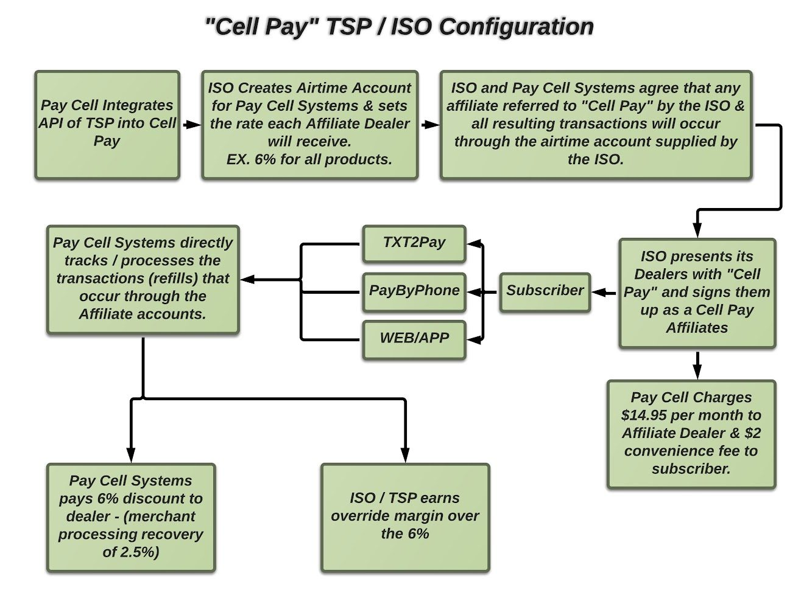</a><br><sub>TSP / ISO configuration</sub></td><td align="center" valign="top"><a href="pc/distributor-direct.jpg">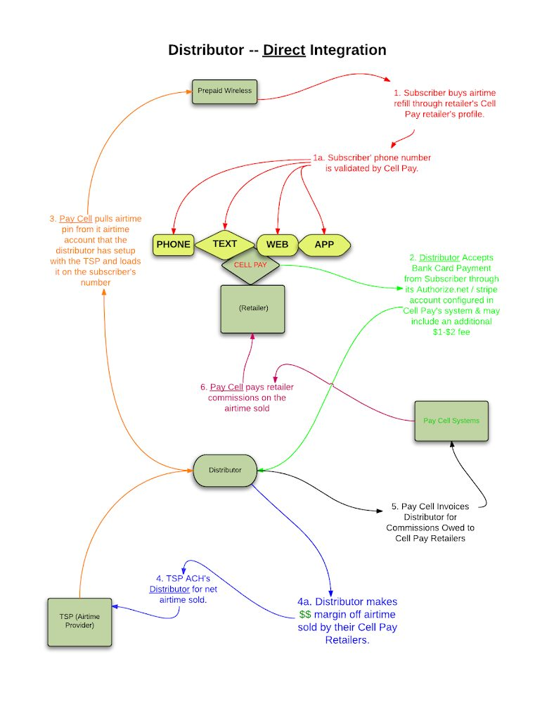</a><br><sub>Distributor direct integration</sub></td><td align="center" valign="top"><a href="pc/distributor-boss.jpg">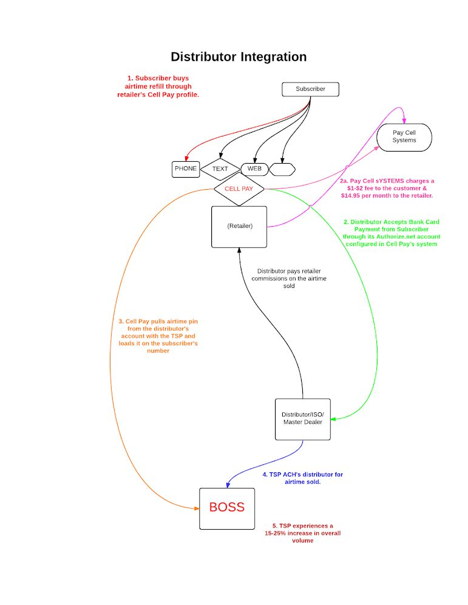</a><br><sub>Distributor integration (Boss)</sub></td><td align="center" valign="top"><a href="pc/distributor-airnet.jpg">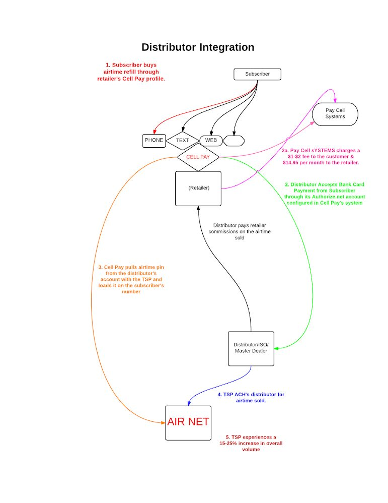</a><br><sub>Distributor integration (Air Net)</sub></td></tr>
<tr><td align="center" valign="top"><a href="pc/distributor-setup.jpg">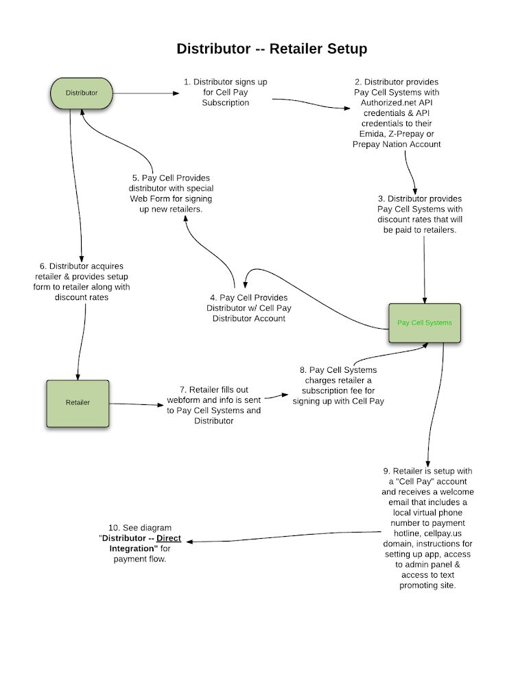</a><br><sub>Distributor and retailer setup</sub></td><td align="center" valign="top"><a href="pc/retailer-gateway.jpg">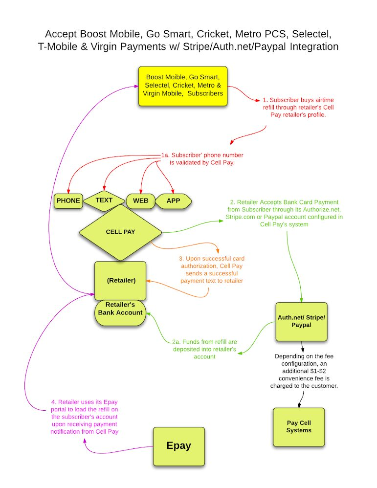</a><br><sub>Retailer gateway integration</sub></td><td align="center" valign="top"><a href="pc/hotline-model.jpg">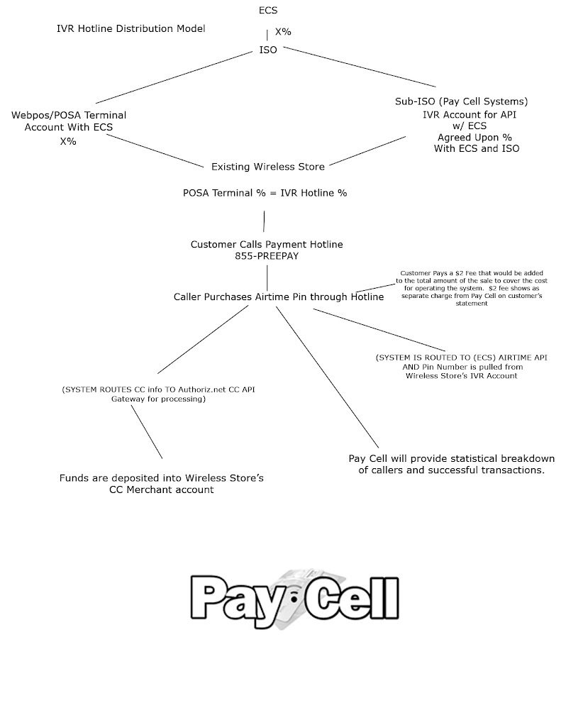</a><br><sub>IVR hotline distribution model</sub></td><td align="center" valign="top"><a href="pc/carrier-taxonomy.jpg">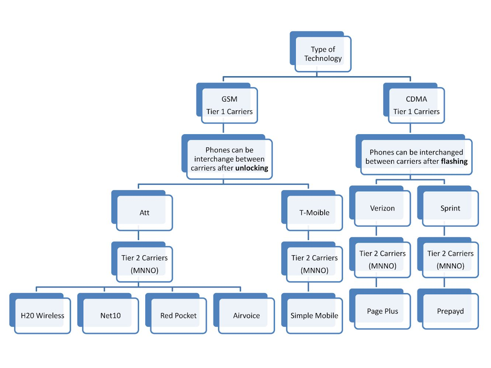</a><br><sub>Carrier taxonomy</sub></td></tr>
</table>

### Domain B · Payment channels

#### Pay-by-Phone IVR

*A 24-hour payment hotline that takes a card payment, buys airtime from the distributor API, and either credits the account or reads back a refill PIN, with per-carrier handling and recovery paths.*

<sub>Source: 5 original call-flow diagrams, built on Ifbyphone</sub>

**Problem**

Nine carriers, two fulfillment types and a caller who can hang up at any step. The flow had to stay short, survive slow upstream APIs, and recover abandoned payments.

**Design**

- Configuration lives outside the call flow: per-company processing fee, Authorize.net login and transaction key, airtime distributor credentials, customer service number and alert email.
- Every call writes one call-detail record (caller ID, carrier, wireless number, price, gateway transaction ID and status, total, PIN). That record later powers PIN retrieval.
- Airtime is purchased through the SoftGate `CellularVoucherPurchase` XML request.
- Two fulfillment branches: real-time reload carriers (T-Mobile, AT&T, Boost) get "payment added"; PIN carriers (Simple Mobile, H2O, Page Plus, Virgin, Airvoice, Cricket) get the PIN read back with carrier-specific load instructions, plus an SMS copy.
- Auto-loading via "click to servo" runs asynchronously. If the response is not back when the caller asks, the IVR plays hold music until it arrives instead of failing.
- Error branches separate "card charged, airtime failed" (transfer to customer service) from "PIN delayed" (callback promise), so a charge is never left unexplained.
- Abandonment recovery: a hangup after choosing an amount triggers an SMS with a fee-waiver promo code. Promo codes also toggle the processing fee.
- Retail attribution: callers enter a store referral code (first letters of the store name), so each payment is credited to the store that activated the line.

**Patterns:** IVR / telephony · Authorize.net · XML API · Async fulfillment · Failure-path design · Attribution

> "The hardest part was the partial-failure case: card approved, airtime not delivered. I gave it its own branch, its own script and a human handoff."


<details>
<summary>Diagram source (Mermaid)</summary>

```text
flowchart TD
  A[Caller dials hotline] --> B[Store or promo code]
  B --> C[Carrier · number · amount]
  C --> D{Accept fee?}
  D -- No --> X[Goodbye]
  D -- Hang up --> H[Recovery SMS<br/>with fee waiver code]
  D -- Yes --> E[Card → Authorize.net]
  E -- Declined --> X
  E -- Approved --> F[Airtime API purchase]
  F -- RTR carrier --> G[Payment added<br/>to account]
  F -- PIN carrier --> P[Read PIN + load steps<br/>SMS copy]
  F -- Error --> CS[Transfer to<br/>customer service]
  P -. async load .-> W[Hold until<br/>servo confirms]
```

</details>

**Originals**

<table>
<tr><td align="center" valign="top"><a href="pc/ivr-master.jpg">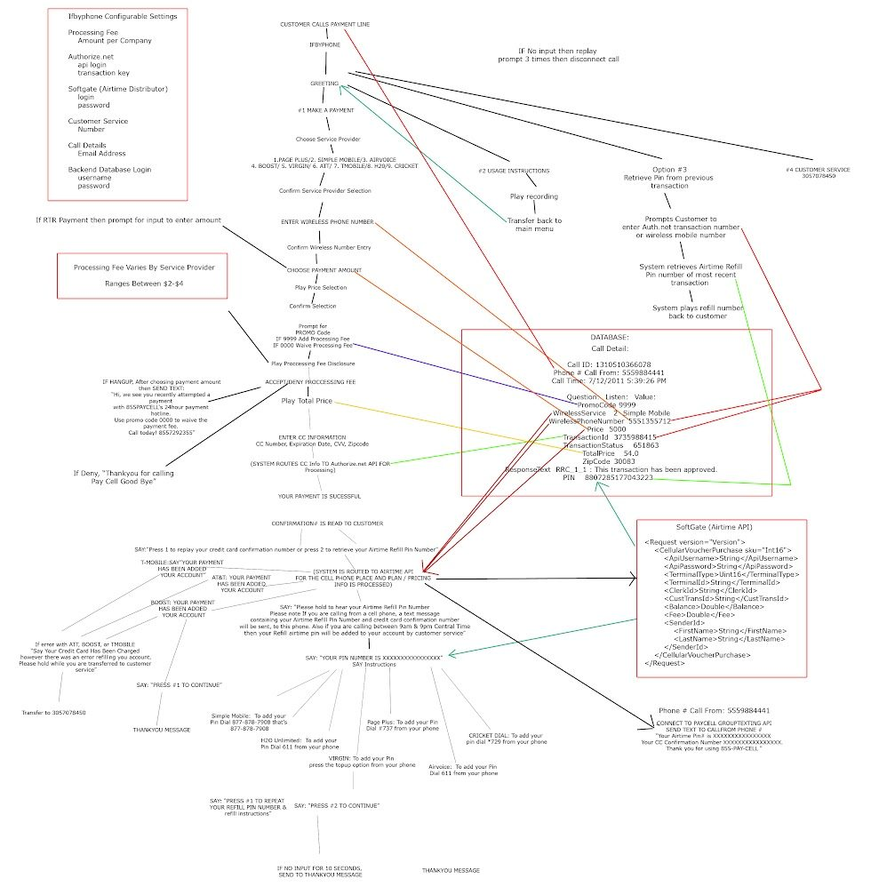</a><br><sub>Master flow + data model</sub></td><td align="center" valign="top"><a href="pc/ivr-post-auth.jpg">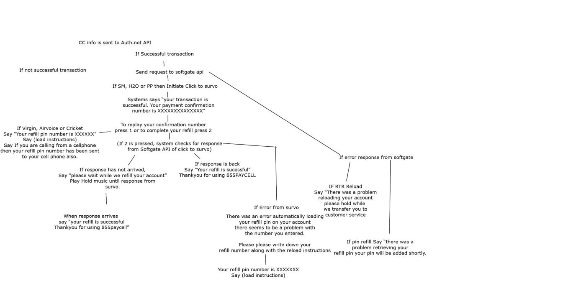</a><br><sub>Post-auth fulfillment</sub></td><td align="center" valign="top"><a href="pc/ivr-promo.jpg">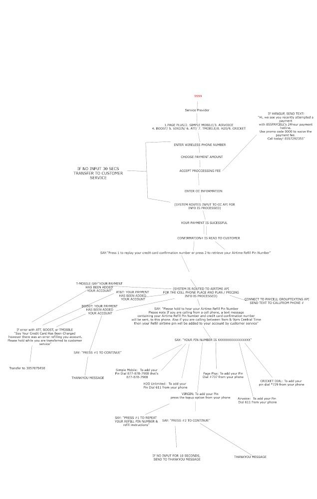</a><br><sub>Promo + hangup recovery</sub></td><td align="center" valign="top"><a href="pc/ivr-referral.jpg">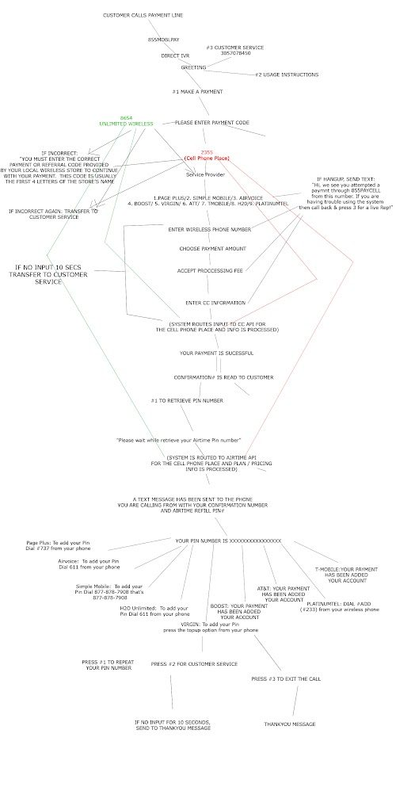</a><br><sub>Store referral codes</sub></td></tr>
<tr><td align="center" valign="top"><a href="pc/ivr-retailer.jpg">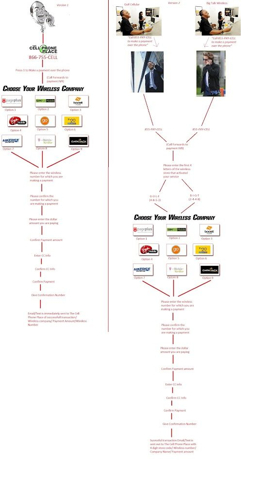</a><br><sub>Retailer-branded IVR v1 / v2</sub></td></tr>
</table>

#### Self-Service Payment Kiosk

*In-store kiosk software for airtime payments, phone and SIM sales, with a magnetic card reader, a bill acceptor, and the same airtime and messaging back end as the IVR.*

<sub>Source: 4 original diagrams (one program flowchart, three menu-tree versions)</sub>

**Problem**

An unattended screen in a store has to recover from walk-aways at every step and must never hold a half-entered card.

**Design**

- At start-up the program loads the service catalog from the site and subscribes to card-reader events, so a swipe can arrive at any point.
- Every step has its own inactivity timeout (5, 5, 3 and 1 minutes, then 30 seconds after the receipt) that returns to the start screen.
- A card swipe pre-fills the form; the program then asks only for CVV and ZIP.
- Cash path: the bill acceptor validates bills against the plan price, with a cancel that returns the cash and an option to keep overpayment as credit.
- The menu grew across three versions: v1 credit only, v2 adds cash, v3 adds a processing-fee consent screen and phone and SIM sales.
- Shared back end: Authorize.net for cards, the airtime API, and the SMS service for PIN and receipt delivery.

**Patterns:** Hardware events · State machine · Timeout handling · Shared services · Iterative releases

> "The kiosk and the IVR were two front ends on one set of services. Adding a channel meant a new UI, not a new payment stack."


<details>
<summary>Diagram source (Mermaid)</summary>

```text
stateDiagram-v2
  [*] --> Init: load catalog, subscribe to card reader
  Init --> Menu
  Menu --> Provider: start pressed
  Provider --> Amount: carrier selected
  Amount --> Fee: amount chosen
  Fee --> Pay: fee accepted
  Fee --> Menu: declined
  Pay --> Card: swipe
  Pay --> Cash: insert bills
  Card --> Confirm: CVV + ZIP
  Cash --> Confirm: amount validated
  Confirm --> Receipt: approved, airtime loaded
  Receipt --> Menu: 30 s
  Provider --> Menu: 5 min idle
  Amount --> Menu: 5 min idle
  Pay --> Menu: 3 min idle
  Confirm --> Menu: 1 min idle
```

</details>

**Originals**

<table>
<tr><td align="center" valign="top"><a href="pc/kiosk-flow.jpg">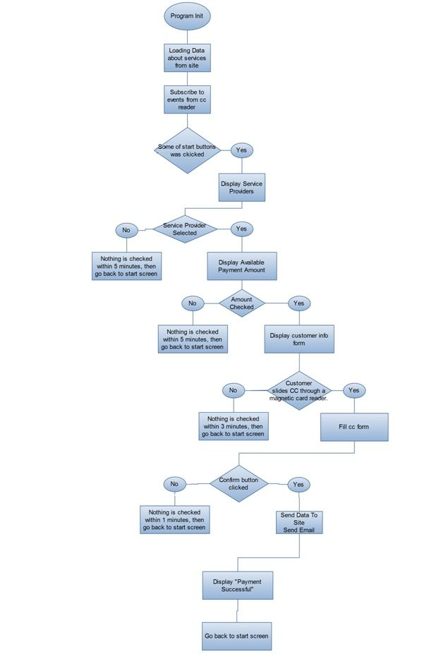</a><br><sub>Program flowchart</sub></td><td align="center" valign="top"><a href="pc/kiosk-tree-v1.jpg">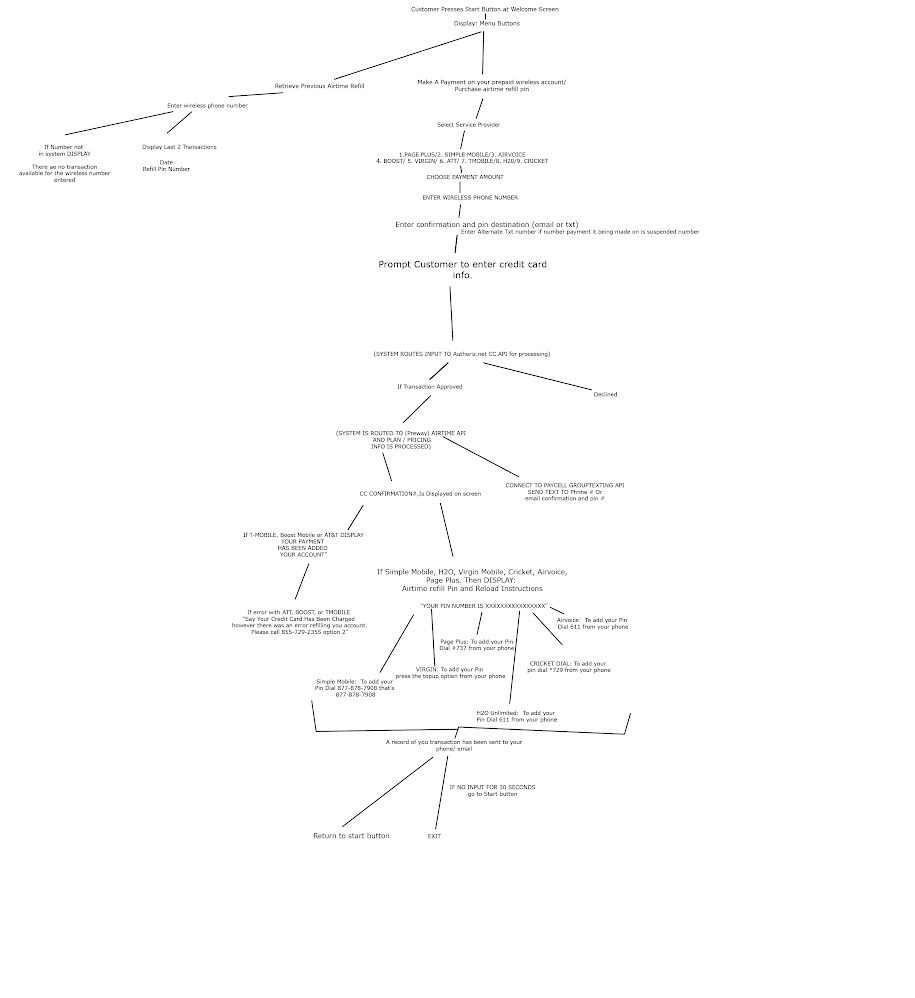</a><br><sub>Menu tree v1</sub></td><td align="center" valign="top"><a href="pc/kiosk-tree-v2.jpg">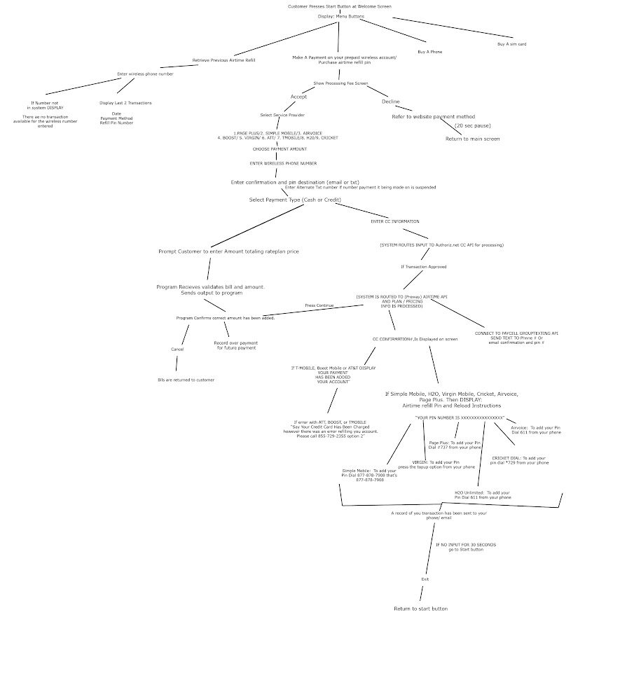</a><br><sub>Menu tree v2</sub></td><td align="center" valign="top"><a href="pc/kiosk-tree-v3.jpg">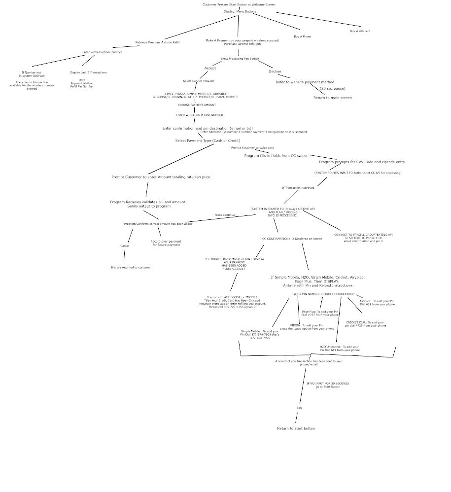</a><br><sub>Menu tree v3</sub></td></tr>
</table>

#### Fulfillment & Card Authentication

*Two supporting designs: a payer-authentication handshake for the mobile app, and an automated dialer that loads PINs on carriers that had no API.*

<sub>Source: 1 UML sequence diagram, 1 dialer flow (original not shown; it contains a phone number)</sub>

**Card authentication**

The phone app posts to a payment gateway service, which looks up the card with Cardinal (a 3-D Secure provider) and redirects the user to enter verification. The gateway then authenticates and receives the values the back-end payment API needs. The app never touches the verification step.

**Automated dialer fulfillment**

- Some carriers accepted PINs only through their own phone menu. The dialer calls the carrier, waits, and sends DTMF tones to walk the menu: carrier prompt, phone number, confirmation, then the 16-digit PIN.
- Voice recognition listens for 25 seconds and classifies the four outcomes (valid or invalid number, valid or invalid PIN).
- Each outcome hangs up and sends its own success or failure email with number and PIN, so operations can fix failures by hand.

**Patterns:** 3-D Secure · UML sequence · Robotic process automation · Outcome classification

> "When a partner has no API, you automate the interface they do have. The dialer was RPA on a phone line, years before that had a name."

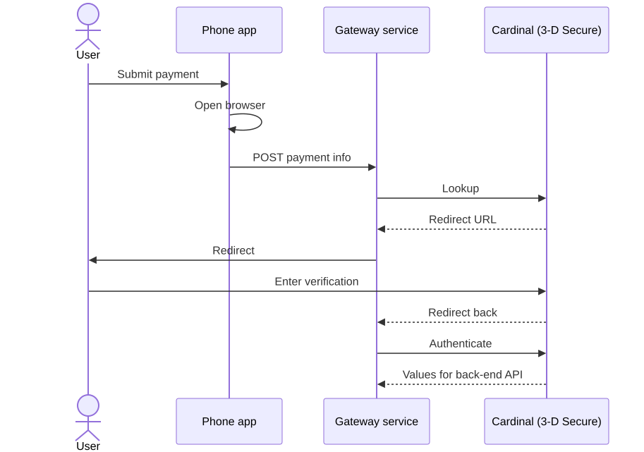

<details>
<summary>Diagram source (Mermaid)</summary>

```text
sequenceDiagram
  actor U as User
  participant A as Phone app
  participant G as Gateway service
  participant C as Cardinal (3-D Secure)
  U->>A: Submit payment
  A->>A: Open browser
  A->>G: POST payment info
  G->>C: Lookup
  C-->>G: Redirect URL
  G->>U: Redirect
  U->>C: Enter verification
  C-->>G: Redirect back
  G->>C: Authenticate
  C-->>G: Values for back-end API
```

</details>

**Originals**

<table>
<tr><td align="center" valign="top"><a href="pc/3ds-sequence.jpg">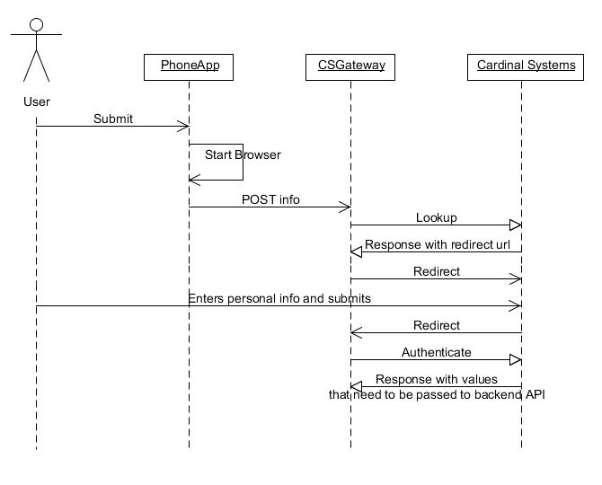</a><br><sub>Authentication sequence</sub></td></tr>
</table>

### Domain C · Early product design

#### Dealer Portal Roadmap

*Whiteboard roadmap for Prepaid-Wireless-Dealers.com, a hub for independent wireless dealers, with each workstream scoped and costed.*

<sub>Source: whiteboard photo, Pay Cell Systems office</sub>

**Problem**

Cell Pay solved payments, but dealers also needed suppliers, messaging, support and reporting. The team needed one view of what to build, buy or white-label next, and what each would cost.

**Design**

- Content and community: news feeds, a supplier directory (master dealers, phones, accessories, SIMs, unlocking, repair) and forums, costed at \$650.
- Messaging: finish the mass-text service, \$800 to build, priced at 4 cents per message.
- Data services: number and PIN validators sold in bulk, with per-validation pricing worked out on the board.
- Build vs buy: hosted IVR and the call center marked "find company" and "find white label" rather than build. The call center was modeled as SaaS with activation, login, FAQs, a \$150 monthly fee and overage.
- Channels: a mobile app at \$2,300, forwarded mail, and a POS system for activations and airtime.
- Partner layer: front-end reporting for ISOs, plus AdSense and affiliate revenue.

**Patterns:** Product roadmap · Build vs buy · Cost estimation · Unit pricing · Partner reporting

> "Each box had a price and a sourcing decision. Half the roadmap was integrate or white-label, which kept the build budget for the parts that were ours."


<details>
<summary>Diagram source (Mermaid)</summary>

```text
flowchart TD
  P((Prepaid-Wireless-Dealers.com))
  P --> C1[Content<br/>news · supplier links · forums $650]
  P --> C2[Messaging<br/>mass text $800 · 4¢/msg]
  P --> C3[Data services<br/>number + PIN validators]
  P --> C4[Buy / white-label<br/>hosted IVR · call center SaaS $150/mo]
  P --> C5[Channels<br/>mobile app $2,300 · POS]
  P --> C6[Partners<br/>ISO reporting · ads · affiliates]
```

</details>

**Original**

<table>
<tr><td align="center" valign="top"><a href="pc/whiteboard-roadmap.jpg">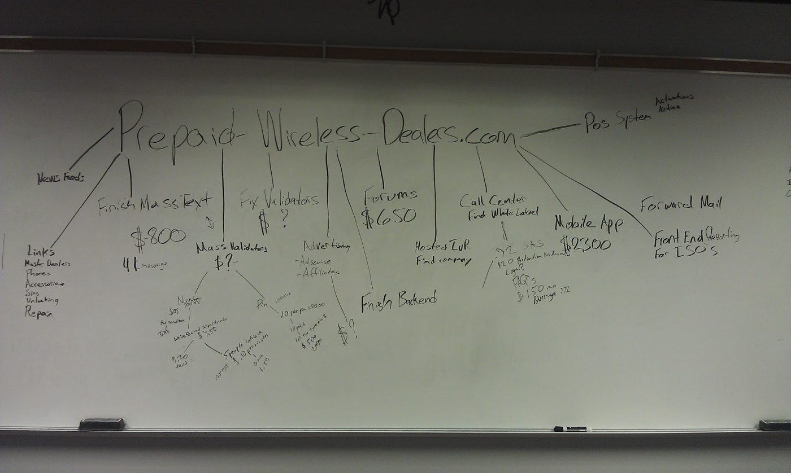</a><br><sub>Roadmap whiteboard</sub></td></tr>
</table>

#### Feature Marketplace Sketch

*Whiteboard design for a Twitter-driven marketplace where buyers pay recording artists for guest features, with escrow and file delivery.*

<sub>Source: whiteboard photo</sub>

**Design**

- Separate buyer and seller sign-ups, each auto-following the brand accounts and announced with a tweet.
- Artist profiles with a request path that reaches the artist by email, inbox or Twitter direct message.
- When the artist agrees, the buyer's payment goes into escrow. Funds release when the artist marks the work complete.
- Delivered audio lands in a shared Dropbox, and a closing tweet tags buyer, seller and artist as social proof.

**Patterns:** Two-sided marketplace · Escrow · Social as event bus

> "Every state change emits a public event. The marketing was a side effect of the workflow."


<details>
<summary>Diagram source (Mermaid)</summary>

```text
flowchart LR
  B[Buyer sign-up] --> L[Browse artists]
  SE[Seller sign-up] --> P[Artist profile]
  L --> R[Request feature]
  P --> R
  R --> A{Artist agrees?}
  A -- Yes --> E[(Escrow)]
  E --> D[Artist delivers<br/>to Dropbox]
  D --> T[Release funds<br/>+ announce tweet]
```

</details>

**Original**

<table>
<tr><td align="center" valign="top"><a href="pc/whiteboard-marketplace.jpg">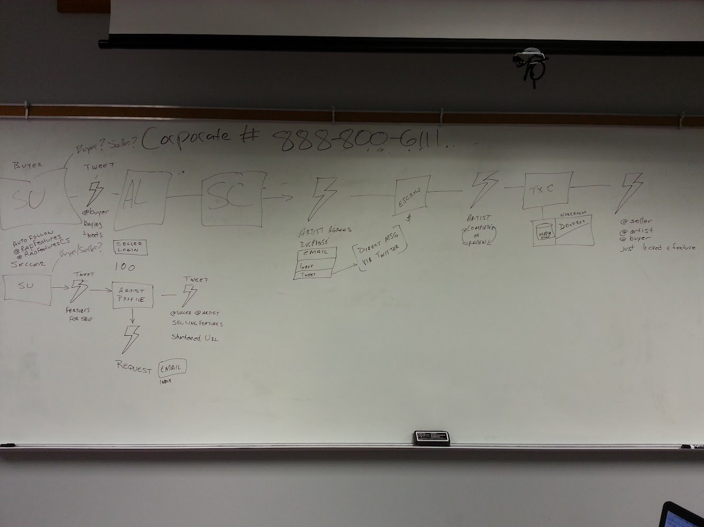</a><br><sub>Whiteboard</sub></td></tr>
</table>

## Held back from the portfolio

- **API flowchart example**: Lucid's stock REST template, not original work.
- **Blank diagram**: empty file.
- **FB Lead Gen Flow**: relies on multiple warmed Facebook accounts behind proxies for outreach. That pattern breaks Meta's terms, and a reviewer at a SaaS or platform company would read it as a risk. The GroupTrack → webhook → Bardeen → GHL enrichment chain inside it is sound and could be redrawn on its own.
- **Automated dialer original**: described above but not shown, because the diagram contains a real wireless number used in testing.
- Client contact first names and the business street address in the lead-flow diagram are left out of this page. The original Lucid file still contains them; scrub it before sharing that link externally.

---

<sub>Original Lucid links open only for accounts with access to the files. Redrawn diagrams on this page are the shareable versions.</sub>
